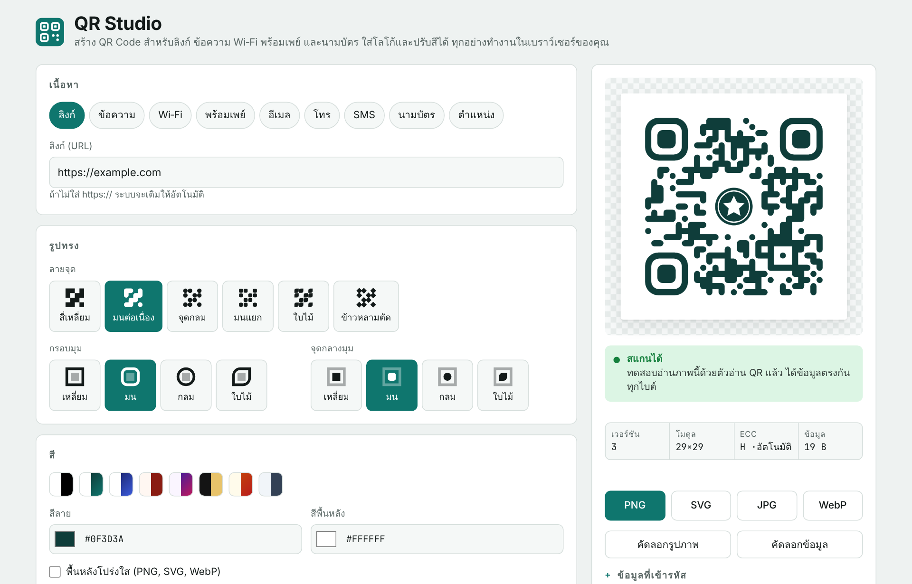

# QR Studio

[](https://woradorn2802.github.io/qr-studio/)


[](LICENSE)

เว็บแอปสร้าง QR Code ภาษาไทย รองรับลิงก์ ข้อความ Wi‑Fi พร้อมเพย์ นามบัตร และอื่น ๆ ใส่โลโก้ ปรับสีและรูปทรงได้ พร้อมตรวจว่าสแกนได้จริงก่อนดาวน์โหลด ทำงานในเบราว์เซอร์ทั้งหมด ไม่ส่งข้อมูลไปยังเซิร์ฟเวอร์

**ทดลองใช้งาน:** https://woradorn2802.github.io/qr-studio/



## สารบัญ

- [ฟีเจอร์](#ฟีเจอร์)
- [เริ่มต้นใช้งาน](#เริ่มต้นใช้งาน)
- [วิธีใช้](#วิธีใช้)
- [รูปแบบข้อมูลที่เข้ารหัส](#รูปแบบข้อมูลที่เข้ารหัส)
- [โครงสร้างโปรเจกต์](#โครงสร้างโปรเจกต์)
- [เทคโนโลยีที่ใช้](#เทคโนโลยีที่ใช้)
- [การรองรับเบราว์เซอร์](#การรองรับเบราว์เซอร์)
- [ความเป็นส่วนตัว](#ความเป็นส่วนตัว)
- [การมีส่วนร่วม](#การมีส่วนร่วม)
- [ข้อจำกัดความรับผิดชอบ](#ข้อจำกัดความรับผิดชอบ)
- [สัญญาอนุญาต](#สัญญาอนุญาต)

## ฟีเจอร์

### ประเภทเนื้อหา

| ประเภท | รายละเอียด |
| --- | --- |
| ลิงก์ | เติม `https://` ให้อัตโนมัติเมื่อไม่ได้ระบุ |
| ข้อความ | รองรับภาษาไทย (เข้ารหัสแบบ UTF‑8) |
| Wi‑Fi | WPA/WPA2/WPA3, WEP, ไม่มีรหัสผ่าน และเครือข่ายซ่อนชื่อ |
| พร้อมเพย์ | เบอร์มือถือ เลขบัตรประชาชน หรือ e‑Wallet ID ระบุจำนวนเงินได้ ตามมาตรฐาน Thai QR Payment (EMVCo) |
| อีเมล | ผู้รับ หัวเรื่อง และเนื้อความ |
| โทร / SMS | เบอร์โทร และข้อความ SMS ที่กรอกไว้ล่วงหน้า |
| นามบัตร | vCard 3.0 (ชื่อ องค์กร ตำแหน่ง โทรศัพท์ อีเมล เว็บไซต์ ที่อยู่) |
| ตำแหน่ง | พิกัดละติจูด/ลองจิจูด เป็นลิงก์ Google Maps หรือ `geo:` URI |

### การปรับแต่ง

- **รูปทรง** — ลายจุด 6 แบบ, กรอบมุม 4 แบบ, จุดกลางมุม 4 แบบ
- **สี** — สีลายและพื้นหลัง, ชุดสีสำเร็จรูป 8 ชุด, พื้นหลังโปร่งใส, ไล่เฉดสี 4 แบบ, แยกสีมุมทั้งสาม
- **โลโก้** — เลือกไฟล์ ลากวาง หรือวางจากคลิปบอร์ด ปรับขนาด (10–30%) ระยะขอบ และแผ่นรองได้ ระบบเว้นลายจุดด้านหลังและใช้ระดับแก้ไขข้อผิดพลาด H ให้อัตโนมัติ
- **ข้อความใต้ภาพ** — เช่น "สแกนเพื่อเข้าเว็บไซต์"
- **ขั้นสูง** — ระดับแก้ไขข้อผิดพลาด L/M/Q/H และขอบว่าง (quiet zone) 0–8 โมดูล

### การตรวจสอบคุณภาพ

- ทดสอบอ่านภาพที่สร้างด้วย [jsQR](https://github.com/cozmo/jsQR) ทุกครั้งที่มีการเปลี่ยนแปลง และเทียบข้อมูลทีละไบต์
- แจ้งเตือนเมื่อคอนทราสต์ต่ำ สีกลับด้าน ขอบว่างน้อย หรือโลโก้ใหญ่เกินไป
- แสดงเวอร์ชัน QR จำนวนโมดูล ระดับแก้ไขข้อผิดพลาด และขนาดข้อมูล

### การส่งออก

- PNG, SVG, JPG และ WebP ขนาด 512 – 4096 px (SVG เหมาะกับงานพิมพ์)
- คัดลอกรูปภาพไปยังคลิปบอร์ด และคัดลอกข้อมูลที่เข้ารหัส

## เริ่มต้นใช้งาน

โปรเจกต์นี้เป็นไฟล์ HTML ไฟล์เดียว ไม่ต้องติดตั้งหรือ build

### ใช้งานออนไลน์

เปิด https://woradorn2802.github.io/qr-studio/

### รันในเครื่อง

```bash
git clone https://github.com/woradorn2802/qr-studio.git
```

```bash
cd qr-studio
```

```bash
python3 -m http.server 8000
```

จากนั้นเปิด http://localhost:8000 หรือดับเบิลคลิก `index.html` เพื่อเปิดในเบราว์เซอร์โดยตรงก็ได้

> ต้องเชื่อมต่ออินเทอร์เน็ต เพราะไลบรารีและฟอนต์โหลดจาก CDN

### เผยแพร่ด้วย GitHub Pages

ไปที่ **Settings → Pages** เลือก **Deploy from a branch** แล้วเลือก branch `main` โฟลเดอร์ `/ (root)`

## วิธีใช้

1. เลือกประเภทเนื้อหาแล้วกรอกข้อมูล
2. ปรับรูปทรง สี และใส่โลโก้ตามต้องการ
3. ตรวจสถานะการสแกนด้านขวา ควรขึ้นว่า **สแกนได้**
4. กดดาวน์โหลดในรูปแบบที่ต้องการ

**คำแนะนำ**

- ใช้ลายสีเข้มบนพื้นสีอ่อน และคอนทราสต์อย่างน้อย 4:1
- เว้นขอบว่างอย่างน้อย 2 โมดูล (แนะนำ 4)
- โลโก้ไม่ควรเกิน 30% ของความกว้าง QR
- ภาษาไทยใช้ 3 ไบต์ต่อตัวอักษร ข้อความยาวจะทำให้ QR ละเอียดและสแกนยากขึ้น
- QR พร้อมเพย์ควรทดลองโอนจำนวนเล็กน้อยก่อนใช้งานจริง

## รูปแบบข้อมูลที่เข้ารหัส

| ประเภท | ตัวอย่าง |
| --- | --- |
| ลิงก์ | `https://example.com` |
| Wi‑Fi | `WIFI:T:WPA;S:MyHome-WiFi;P:welcome2026;;` |
| พร้อมเพย์ | `00020101021129370016A000000677010111011300668123456785802TH530376463045D82` |
| อีเมล | `mailto:contact@example.com?subject=...` |
| โทร | `tel:021234567` |
| SMS | `SMSTO:0812345678:ข้อความ` |
| นามบัตร | `BEGIN:VCARD` … `END:VCARD` |
| ตำแหน่ง | `https://maps.google.com/?q=13.7563,100.5018` |

## โครงสร้างโปรเจกต์

```
qr-studio/
├── index.html               # เว็บแอปฉบับสมบูรณ์ (ใช้กับ GitHub Pages)
├── src/
│   └── artifact-body.html   # ต้นฉบับสำหรับเผยแพร่เป็น Claude Artifact (ไม่มี <html>/<head>)
├── docs/
│   └── screenshot.png       # ภาพหน้าจอใน README
├── LICENSE
└── README.md
```

> เมื่อแก้ไขโค้ด ให้แก้ทั้ง `index.html` และ `src/artifact-body.html` ให้ตรงกัน

## เทคโนโลยีที่ใช้

- HTML, CSS และ JavaScript แบบไม่ใช้เฟรมเวิร์ก
- [qrcode-generator](https://github.com/kazuhikoarase/qrcode-generator) 1.4.4 — สร้างเมทริกซ์ QR
- [jsQR](https://github.com/cozmo/jsQR) 1.4.0 — ทดสอบการอ่าน QR
- ฟอนต์ [Bai Jamjuree](https://fonts.google.com/specimen/Bai+Jamjuree), [IBM Plex Sans Thai](https://fonts.google.com/specimen/IBM+Plex+Sans+Thai) และ [JetBrains Mono](https://fonts.google.com/specimen/JetBrains+Mono) จาก Google Fonts
- วาดภาพด้วย Canvas 2D (`Path2D`) และสร้าง SVG จากเรขาคณิตชุดเดียวกัน

## การรองรับเบราว์เซอร์

Chrome, Edge, Firefox และ Safari รุ่นปัจจุบัน ทั้งเดสก์ท็อปและมือถือ รองรับโหมดสว่างและมืดตามการตั้งค่าของระบบ

การคัดลอกรูปภาพขึ้นอยู่กับว่าเบราว์เซอร์อนุญาต Clipboard API หรือไม่ ถ้าใช้ไม่ได้ให้ดาวน์โหลดเป็น PNG แทน

## ความเป็นส่วนตัว

ข้อมูลทั้งหมด รวมถึงโลโก้ที่อัปโหลด ประมวลผลในเบราว์เซอร์ของผู้ใช้เท่านั้น ไม่มีการส่งไปยังเซิร์ฟเวอร์ใด ๆ

## การมีส่วนร่วม

ยินดีรับ issue และ pull request

1. Fork repository นี้
2. สร้าง branch ใหม่ เช่น `feature/new-qr-type`
3. Commit การเปลี่ยนแปลง
4. เปิด pull request พร้อมอธิบายสิ่งที่เปลี่ยน

## ข้อจำกัดความรับผิดชอบ

QR Studio เป็นเครื่องมือสำหรับการใช้งานที่ถูกกฎหมายเท่านั้น ผู้ใช้เป็นผู้รับผิดชอบต่อเนื้อหาที่ตนเข้ารหัสใน QR Code และการนำ QR Code ไปใช้แต่เพียงผู้เดียว

ผู้พัฒนาไม่มีส่วนเกี่ยวข้องและไม่รับผิดชอบต่อการนำซอฟต์แวร์นี้ หรือ QR Code ที่สร้างจากซอฟต์แวร์นี้ ไปใช้ในทางที่ผิดกฎหมายหรือก่อให้เกิดความเสียหาย เช่น การหลอกลวงด้วย QR พร้อมเพย์หรือลิงก์ปลอม (quishing) รวมถึงไม่รับผิดชอบต่อโค้ดที่บุคคลอื่นนำไปดัดแปลงหรือเผยแพร่ต่อ

## สัญญาอนุญาต

เผยแพร่ภายใต้ [MIT License](LICENSE) © 2026 woradorn2802

ซอฟต์แวร์นี้ให้ไว้ "ตามสภาพ" (AS IS) โดยไม่มีการรับประกันใด ๆ และผู้พัฒนาไม่ต้องรับผิดต่อความเสียหายที่เกิดจากการใช้งาน ดูรายละเอียดทั้งหมดในไฟล์ [LICENSE](LICENSE)
